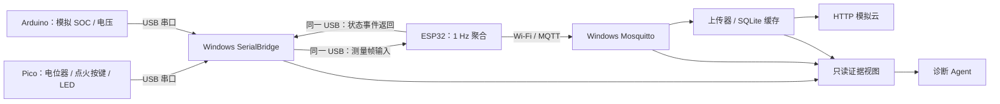

# 车联网诊断 Agent：模拟台架规划

> **2026-10-25 · 计划归档 · 尚未实施**
>
> 板卡尚未到货。本仓库目前只保存设计文档，没有已实现的 Agent、固件、安装脚本或实验结果。具体板型、USB/Wi-Fi 能力、外设接线、驱动兼容性及性能均待实物验证；六周排期从到货核查完成后起算。

目标是利用 Windows 电脑、ESP32、Raspberry Pi **Pico**、Arduino 和现有传感器/交互外设，搭建可复现故障的车联网诊断台架。Pico 是微控制器，不是运行 Linux 的树莓派单板电脑。所有车辆信号均为模拟数据，不连接真实 CAN、OEM 车机或车辆控制接口。

三块板分别通过 USB 连接电脑。SerialBridge 独占三路串口，只封装、转发和记录链路事实；ESP32 经 Wi-Fi/MQTT 完成正常上传。Agent 通过七个固定只读工具查询证据，最多三轮补证，不持有串口写权限、测试控制凭据或执行车辆动作的能力。HTTP 模拟云用于验证数据上传；可选云端 LLM 用于辅助诊断，两者是不同服务。

完整的接线规划、帧协议、权限边界、故障矩阵、验收目标、六周里程碑和 GitHub 参考项目见 **[模拟台架实施计划](docs/simulation-plan.md)**。

首期计划验证单节点 USB 中断、桥接进程停止、ESP USB 中断、Wi-Fi 中断、Broker 停止、MQTT 认证失败、HTTP 503/超时及恢复。每种场景计划重复五次；90% 有证据层级定位、5 秒本地告警、30 秒本地诊断和连续运行两小时均为**待验证目标，不是实测结果**。

本次归档仅创建文档，不安装依赖、不烧录固件、不接线、不运行实验。
