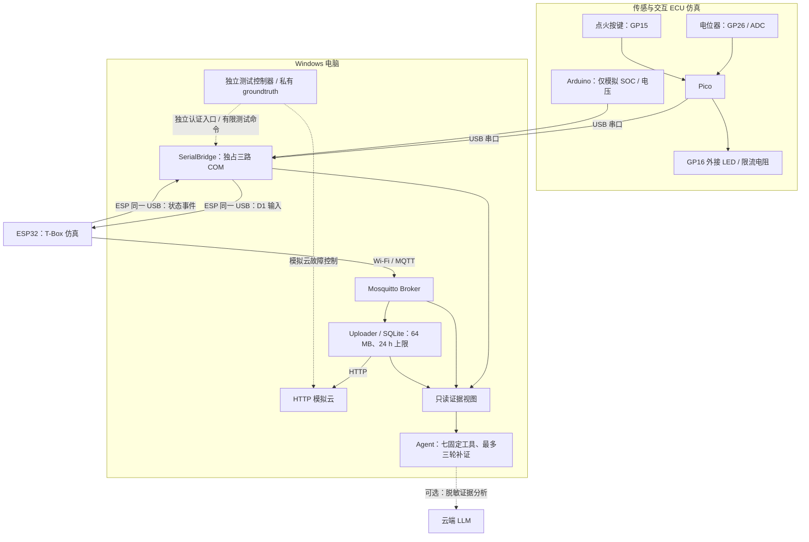

# 车联网诊断 Agent 模拟台架实施计划

## 1. 状态、目标与边界

**归档日期：2026-10-25。状态：方案规划，尚未实施。**

- 板卡尚未到货；没有已完成的软件、固件、接线、测试或性能数据。
- 已知板卡家族为 Raspberry Pi Pico、ESP32、Arduino；具体型号、USB 串口能力、Wi-Fi 能力、传感器型号和可用驱动待核实。
- Pico 是微控制器，不运行 Linux，不承载 Agent、Mosquitto 或数据库。Windows 电脑承担软件宿主。
- 目标是在模拟 ECU—T-Box—云端链路上，根据真实观测定位故障层级、整理证据和建议下一步人工检查。
- 所有“车速、点火、SOC、电压”均为台架模拟量，不代表真实车辆测量；USB 串口转发用于模拟车内数据链路，不是 CAN、UDS、DoIP 或 OEM 接口。
- Agent 首期只读，不自动修复、不改配置、不重启设备、不控制外设；故障注入由独立测试控制器执行。
- 六周是条件性排期，从板卡到货并完成型号、接口、供电与开发环境核查后起算。

## 2. 默认架构与硬件分工



### 接线与职责

| 节点 | 计划职责 | 接线与前置核查 |
| --- | --- | --- |
| Pico | 电位器映射 0–120 km/h 模拟车速；按键切换模拟点火状态；LED 指示点火状态 | 电位器两端接经核实的 3.3 V 与 GND，滑端接 GP26；GP15 按键使用内部上拉、按下接地并去抖；GP16 驱动外接 LED，必须串联按 LED 参数和 GPIO 能力选定的适当限流电阻。实物引脚和供电核实后再接线 |
| Arduino | 仅按预设序列生成模拟 SOC 与电压，不接真实动力电池 | USB 接电脑；型号、Serial 行为和枚举信息待确认 |
| ESP32 | 接收桥转发的测量帧、检查新鲜度、1 Hz 聚合、经 Wi-Fi/MQTT 上传、输出自然运行状态 | USB 接电脑；必须核实实际开发板的可用串口、Wi-Fi 能力和固件支持 |
| Windows 电脑 | 串口桥、Broker、上传缓存、模拟云、只读 Agent、测试控制器 | 需同时连接三板并接入现有路由器；核实 USB 端口/Hub、数据线、供电、驱动、2.4 GHz 网络与局域网互通 |

默认仅通过 USB 连接三块板与电脑，不安排跨板 GPIO/UART 直连。后续若改用 Pico→ESP 的 3.3 V UART，必须重新确认型号、电平、引脚和供电；这不是首期默认方案。外设尚未到货，不把任何接线描述视为已经验证。

### SerialBridge 与 ESP32 行为

- 一个 SerialBridge 进程持有 Pico、Arduino、ESP32 三路 COM，使用独立读循环与有界队列；ESP 串口故障不能阻塞另外两路采集。
- 使用 USB 设备标识和固件握手节点 ID 绑定设备，避免把 COM 编号或枚举先后当作设备身份；处理热插拔、串口重枚举及部分板卡打开串口时的复位行为。
- Bridge 只做分帧、校验、封装、转发、计数和链路错误记录；不执行诊断决策，不替传感器生成新测量，不绕过 ESP 直接发布最终车辆遥测。
- ESP32 的同一 USB 串口全双工承载“电脑→ESP 的测量输入”和“ESP→电脑的自然状态事件”；测试控制响应单独分流。普通调试文本不能被误当作测量帧。
- ESP32 每秒聚合一次。某个来源连续 3 秒没有新有效帧即标记 stale；保留最后值及其年龄，但不得将旧值重标为新测量。
- ESP32 使用 RAM 保存最多 60 条待发聚合记录。满时丢弃最旧记录并累计丢弃数；重连按序尝试补发、保留原始时间与序号，不能伪装成当前实时数据。断电不承诺保存 RAM 缓存。
- MQTT 正常上传只从 ESP32 指向 Broker；不采用 Broker→ESP 的 MQTT ingress 来模拟车内总线。

## 3. 数据、缓存与观测接口

### 统一串口测量帧

计划使用以下 ASCII 短帧，换行结束，整帧上限 128 B：

```text
D1,node,session,seq,uptime_ms,value1,value2*crc16
```

- `node` 标识 Pico 或 Arduino；`session` 在节点启动时建立，由握手通知 Bridge，并在该启动会话内保持不变。
- Bridge 为每次打开的设备完成节点/会话握手；未知节点、会话尚未确认或错误方向的帧不进入正常转发。串口重连先重做握手，不单凭 COM 重连推断 MCU 已重启。
- `seq` 为来源节点递增的帧序号；`uptime_ms` 为该节点启动后的毫秒计数，不能直接与其他节点的 uptime 相减计算时延。
- Pico 的 `value1` 为映射到 0–120 km/h 的模拟车速，`value2` 为模拟点火状态；Arduino 的 `value1` 为模拟 SOC，`value2` 为模拟电压。数值单位固定在协议定义中，不允许按消息内容临时猜测。
- `crc16` 覆盖从 `D1` 至 `value2` 的原始 ASCII 字节，不包含 `*`、CRC 字段和换行。实现时统一使用 CRC-16/CCITT-FALSE：多项式 `0x1021`、初值 `0xFFFF`、不反射、最终异或 `0x0000`，输出四位十六进制。
- Bridge 校验长度、字段、CRC 和来源后原样保留 `node/session/seq/uptime_ms`，另外记录电脑接收时间；ESP 聚合遥测仍保留每个来源的标识、会话与序号。
- 握手、自然状态和测试命令使用独立帧类型；接收端按类型及方向路由，不将命令、ACK 或调试输出当作 D1 数据。
- MQTT/云端使用来源帧标识与 T-Box 会话/聚合序号识别重复数据；不能只依赖 MQTT `dup` 标志。遥测默认 `retain=false`，不把历史重放混入实时数据路径。

### 上传与本地保存

- MQTT topic 按台架与节点固定命名，遥测和健康状态分开；发布者、上传器和观测端使用不同凭据与最小 topic 权限。
- Mosquitto 仅用于 ESP→电脑的真实 Wi-Fi/MQTT 上传段；Broker 不同时充当仿真车内总线。
- Windows 上传器订阅有效遥测，经 HTTP 发送至模拟云，并将失败批次放入 SQLite；模拟云按记录标识去重。
- SQLite 持久化按最大 64 MB、最长 24 小时设计，达到任一上限即清理最旧数据并记录清理数量；实现时将数据库与 WAL 等实际磁盘占用纳入预算验证，不能只限制单表条数。
- 云端错误采用有限并发和退避重试；保留原始采集时间、入队时间、尝试次数、请求 ID 与最后错误，重传不覆盖测量来源。
- HTTP 模拟云负责数据接收、确认及可控错误响应；可选云端 LLM 只接收必要脱敏证据用于分析。LLM 不可用时，本地规则告警、证据查询和模板报告仍应可用。

### 七个固定只读工具

下列是计划接口，不是目前已有程序。所有查询使用固定节点、固定目标和有界时间窗口，不接受任意 Shell、文件路径或外部 URL。

| 工具 | 返回的只读证据 |
| --- | --- |
| `get_node_status` | Pico/Arduino 的会话、最后有效帧、源序号、接收时间与 stale 状态 |
| `get_bridge_status` | Bridge 进程心跳、各串口状态、收发/错误/丢弃计数及队列深度 |
| `get_esp_status` | ESP 自然状态事件：串口 ingress、各源最后序号、Wi-Fi/MQTT 状态、聚合/缓存计数 |
| `get_mqtt_events` | Broker 连接、断开、认证失败和遥测接收事件 |
| `get_upload_queue` | SQLite 待传数量/大小、记录年龄、最近上传结果、重试与清理计数 |
| `probe_mock_cloud` | 对预先配置的模拟云健康端点进行有超时限制的只读探测，返回连接、HTTP 状态与耗时 |
| `get_evidence_window` | 给定时间窗口内的事件时间线、遥测摘要与可追溯证据 ID |

Agent 每次诊断最多进行三轮工具补证，然后输出“观测现象—证据—故障层级—候选原因—下一步人工检查”。证据不足时应保留不确定性，不强猜唯一根因。MQTT PUBACK 仅证明 Broker 收到消息，不能替代 ESP 已处理来源数据的证据。

诊断分层依次为：传感/节点、USB/串口、Bridge、ESP 聚合、Wi-Fi/MQTT、上传队列/HTTP 模拟云。Bridge 停止由独立只读进程监视证据识别，不能只依赖 Bridge 自报心跳。

## 4. 只读边界与故障评测

### 权限与评测隔离

- Agent 仅访问证据视图和七个工具，不打开 COM 口，不拥有串口写、MQTT 发布、服务停止、配置修改或故障注入权限。
- 独立测试控制器通过带 token 的受限入口向 Bridge 发有限台架测试命令；控制器不直接争用 COM。模拟云的故障控制入口另行鉴权，不暴露给 Agent。
- 测试控制命令、控制 ACK、场景名称、预期答案与 groundtruth 保存在私有记录中，不进入 Agent 可见日志、遥测字段、证据视图或 LLM 上下文。
- Agent 可以看到真实自然观测，例如认证失败、串口消失、队列增长；不能看到“当前注入的是 Wi-Fi 故障”等答案标签。
- 每轮先冻结 Agent 报告，再由评测器读取 groundtruth 对比。测试期间随机化正常/故障顺序，保留报告与证据 ID 的对应关系。
- 测试控制器仅操作台架组件；本计划不包含真实车辆动作或任何 OEM 授权流程。

### 故障与恢复矩阵

每项计划重复五次。下表描述待实施的测试，不表示已经复现或通过。

| 场景 | 计划注入方式 | 应记录的证据与合理定位 |
| --- | --- | --- |
| 正常运行 | 全链路启动，转动电位器、按点火按钮，Arduino 正常输出 | 各跳序号推进、LED/点火一致、1 Hz 聚合、队列稳定；作为误报基线 |
| 单节点 USB 中断 | 分别拔下 Pico 或 Arduino USB 后重连 | 对应串口消失/读错误、单源 stale；ESP 心跳及其他来源仍可观测；定位至节点/USB范围，不无证据断言板卡损坏 |
| Bridge 停止 | 由测试控制器停止 Bridge 后恢复 | 外部进程心跳中断、ESP 输入停止但 Wi-Fi 心跳可继续；恢复后重做握手 |
| ESP USB 中断 | 断开 ESP USB 后重连 | Bridge 的 ESP 端口错误、来源节点采集仍独立记录；若 USB 同时是唯一电源，必须将“ESP 同时掉电”记入 groundtruth，不能宣称是纯数据线故障 |
| ESP Wi-Fi 中断 | 经受限测试入口令 ESP 定时断开 Wi-Fi，保持 USB 可用 | ESP 自然 Wi-Fi 状态变化、MQTT断连、RAM缓存增长；不把只见遥测缺失视为已证实 Wi-Fi根因 |
| Broker 停止 | 停止本台架 Mosquitto 后恢复 | Broker进程/监听状态、ESP连接错误，USB输入仍正常；区分局域链路与Broker服务层 |
| MQTT 认证失败 | 测试控制器使用测试错误凭据重连，随后还原 | Broker认证拒绝、ESP MQTT错误、Wi-Fi仍连接；定位至MQTT认证层 |
| HTTP 503 | 模拟云真实返回503，再恢复正常响应 | 请求ID、HTTP状态、重试、队列增长，局域MQTT仍正常；定位至云端HTTP服务层 |
| HTTP 超时 | 模拟云延迟超过上传器超时，再恢复 | 实际请求耗时、超时与积压；只能据证据描述请求超时，不直接等同于已证实网络丢包 |
| 恢复 | 对上述故障分别恢复组件并检查端到端数据 | 会话/序号连续性、stale解除、缓存清空或明确丢弃、重复去除；旧数据不伪装成新数据 |

### 验收目标：全部待实测

- 每种故障场景五次；至少 90% 的故障试次能够引用证据定位到上述合理层级。按层级定位评分，不强求仅凭有限观测区分所有物理原因。
- 每个诊断结论必须可追溯至证据 ID、采集时间与对应节点/会话；正常场景单独记录误报情况。
- 对存在足够本地观测的异常，目标在 5 秒内产生本地告警、30 秒内形成带证据的本地诊断报告；云端 LLM 延迟不作为已有保证。
- 全链路目标连续运行至少两小时，记录进程资源、队列边界、USB重连和数据丢弃；64 MB/24小时清理规则需单独验证，不能仅用两小时运行证明24小时保留行为。
- 检查 Agent 没有串口写/控制凭据访问路径，私有groundtruth不会进入上下文；无法归因时报告不确定性。

## 5. 六周里程碑

以下排期从到货核查完成后起算；未开始计时。

| 周次 | 工作内容 | 计划交付与检查 |
| --- | --- | --- |
| 第1周 | 核实三板型号、USB/Wi-Fi、传感器/LED/按键接口与电气参数；建立开发环境；完成Pico交互及Arduino模拟量输出 | 硬件清单、经确认接线图、短帧与会话握手定义、单节点串口采集记录 |
| 第2周 | 实现三COM独占Bridge、输入分流、CRC校验与热插拔；ESP接收来源帧、1Hz聚合、3秒stale及状态事件 | USB仿真车内数据链路，来源序号追踪与桥接健康证据 |
| 第3周 | 接入Wi-Fi/MQTT、Mosquitto、ESP RAM 60条缓存、Python上传器、SQLite与HTTP模拟云 | 端到端遥测、上传确认、重复去除、64MB/24小时清理设计及基础验证 |
| 第4周 | 实现只读证据视图、七工具、最多三轮补证与报告；接入可选云LLM及离线模板降级 | 证据追溯报告、权限隔离检查；明确模拟云与LLM服务边界 |
| 第5周 | 实现独立测试控制器及私有groundtruth，执行正常/故障/恢复矩阵，每项五次 | 原始证据、固定报告与评分；检查标签泄漏、误报、错误归因和恢复行为 |
| 第6周 | 修复重连、重枚举、队列边界、回环/重放与可观测性问题；连续运行两小时并整理演示 | 验收结果、未通过项、复现步骤、资源数据及下一阶段建议；不把目标改写成未取得的实测结果 |

## 6. 技术参考与后续扩展

以下为调研参考，不表示已经集成、安装、构建或验证；实施时固定具体版本并复核许可证、接口及目标板兼容性。

| 项目/资料 | 在本计划中的用途 |
| --- | --- |
| [Raspberry Pi Pico SDK](https://github.com/raspberrypi/pico-sdk)、[pico-examples](https://github.com/raspberrypi/pico-examples) | Pico的ADC、GPIO、USB串口与基础固件参考 |
| [ArduinoCore-avr](https://github.com/arduino/ArduinoCore-avr) | UNO级Arduino的Serial与固件参考；最终按实际板型选择对应Core |
| [ESP-IDF](https://github.com/espressif/esp-idf)、[ESP-MQTT](https://github.com/espressif/esp-mqtt) | ESP32的Wi-Fi、MQTT、认证、连接事件与任务实现参考 |
| [Eclipse Mosquitto](https://github.com/eclipse-mosquitto/mosquitto) | Windows MQTT Broker；配置监听、认证和topic ACL |
| [pySerial](https://github.com/pyserial/pyserial) | Windows三COM采集/转发参考 |
| [Eclipse Paho MQTT Python](https://github.com/eclipse-paho/paho.mqtt.python) | Python遥测订阅、重连、发布确认及事件观测参考 |
| [PicoClaw](https://github.com/sipeed/picoclaw)、[ZeroClaw](https://github.com/zeroclaw-labs/zeroclaw) | 借鉴轻量Agent循环、模型适配和工具接口；不直接开放其通用Shell/文件写/自主执行能力 |
| [Eclipse Kuksa Databroker](https://github.com/eclipse-kuksa/kuksa-databroker)、[COVESA VSS](https://github.com/COVESA/vehicle_signal_specification) | 后续车辆信号语义与适配层参考，首期不要求部署整套SDV栈 |
| [Tesla Fleet Telemetry](https://github.com/teslamotors/fleet-telemetry)、[Vehicle Command SDK](https://github.com/teslamotors/vehicle-command) | 参考车端遥测、连接观测与授权边界；本台架不调用Tesla车辆、也不取得OEM系统权限 |

Windows最小运行依赖计划为Mosquitto、Python 3、`pyserial`、`paho-mqtt`；JSON、SQLite、HTTP与日志使用Python标准库。Pico SDK、Arduino Core与ESP-IDF属于固件开发环境，按板型确认后安装。本次归档不安装任何依赖。

首期完成后再讨论真实CAN/UDS/DoIP、蜂窝网络、外接网关或车企内部日志适配。真实车机系统即使采用Linux/Android，也不能从系统名称或开源包推断可安装Agent；本计划对OEM接入和量产适用性不作已验证承诺。
